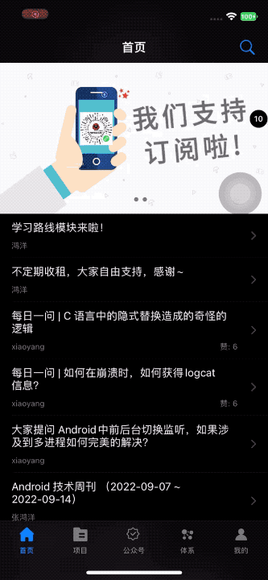
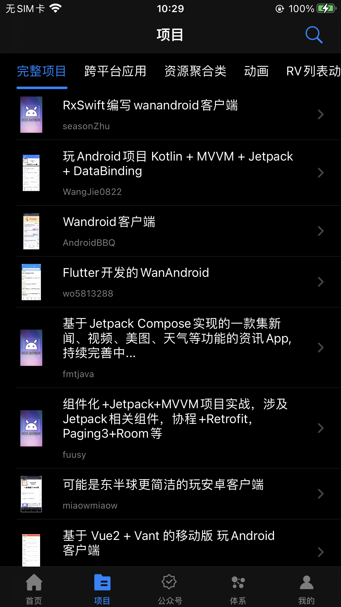
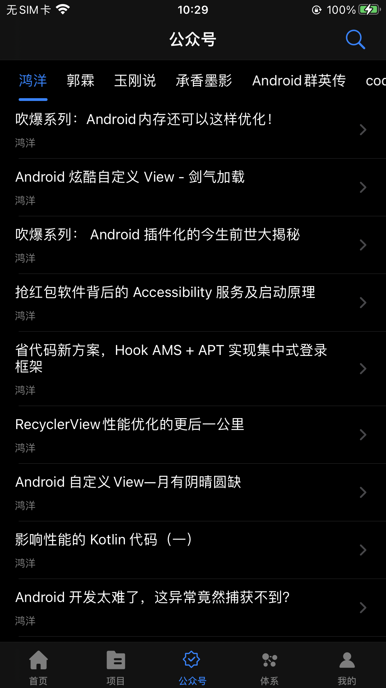
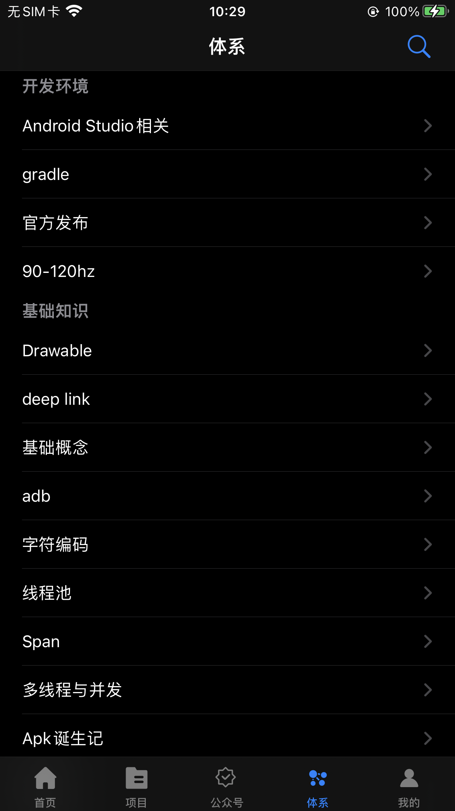
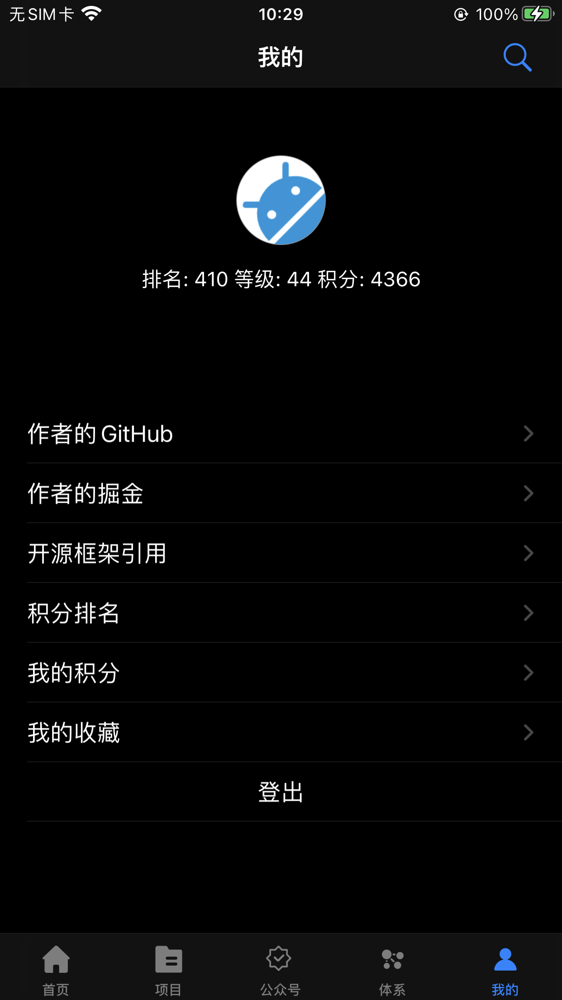
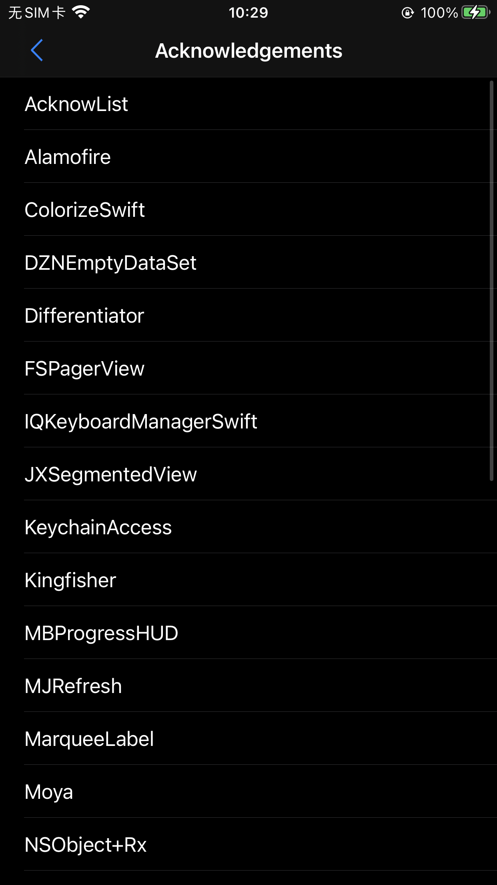
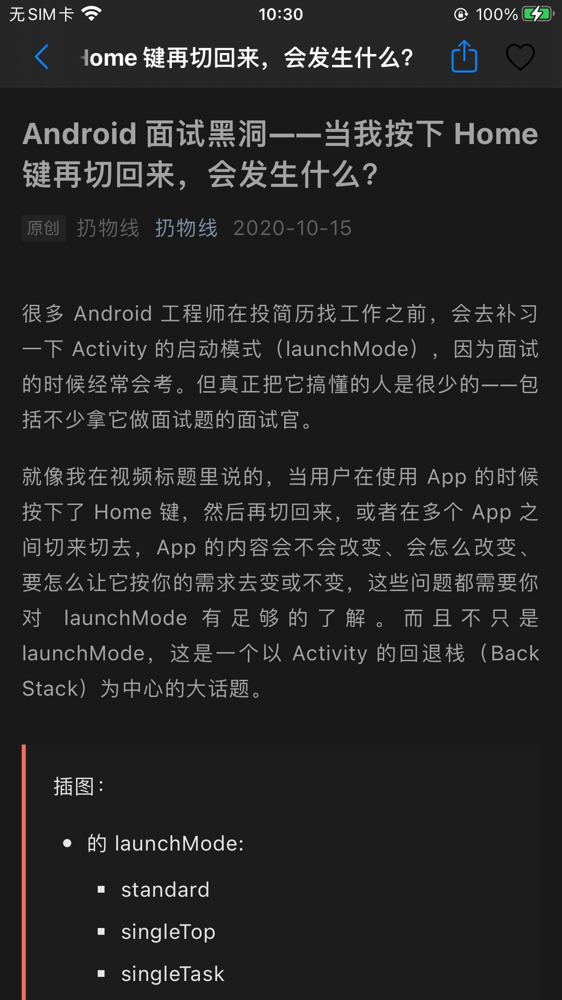

# RxStudy：WanAndroid iOS 学习项目

基于 [WanAndroid 开放 API](https://www.wanandroid.com/) 的 iOS 客户端，包含 UIKit + RxSwift 与独立 SwiftUI 两种实现，用于学习 MVVM、响应式编程、网络请求及页面状态管理。

这是我的第一个 Swift MVVM 项目，从 RxSwift 学习实践开始，逐步加入 Combine、SwiftUI、组件化和跨端集成实验。欢迎 Star、提交 PR 和交流实现思路。

[快速开始](#快速开始) · [开发指南](DEVELOPMENT_GUIDE.md) · [构建方式切换](docs/构建方式切换速查.md) · [文档导航](#文档导航)

## 两个应用 Target

| Target / Scheme | 实现方式 | 代码入口 |
| --- | --- | --- |
| `RxStudy` | UIKit + RxSwift / RxCocoa，包含原有学习示例和跨端集成实验 | [RxStudy](RxStudy) |
| `SwiftUIStudy` | 独立 SwiftUI 应用，包含首页、分类、搜索、登录、收藏、积分等页面 | [SwiftUIStudy](SwiftUIStudy) |

两个构建分支都包含这两个应用 Target。选择 CocoaPods 或 Tuist 不会改变页面使用的 UI 技术。

## 界面预览

以下动图和截图为项目早期 UIKit 版本的历史展示，不代表当前两个 Target 的全部界面。



|  |  |  |  |
| --- | --- | --- | --- |
|  |  |  |  |

## 功能与学习内容

主要业务页面包括：

- 首页、项目、公众号、体系、我的五个模块。
- 登录与注册、热门搜索与文章搜索。
- 文章列表、详情浏览与收藏。
- 积分与积分排名。
- 轮播、下拉刷新、分页加载及加载／空数据／错误状态展示。
- 深色模式适配。

两个 Target 的具体交互和完成情况以各自实现为准，可以结合源码对照学习：

- UIKit 中的 RxSwift / RxCocoa 事件处理、ViewModel 绑定与 MVVM 页面组织。
- Moya 网络请求封装、插件及登录状态处理。
- 独立 SwiftUI 应用的页面拆分、状态管理和通用列表组件。
- UIKit 内嵌 SwiftUI、Combine 请求与积分排名示例，位于 [RxStudy/SwiftUIExample](RxStudy/SwiftUIExample)。
- 共享 API、模型、登录 Cookie 和资源代码，位于 [Shared](Shared)。

## 核心技术

| 用途 | 技术或组件 |
| --- | --- |
| UI 与状态 | UIKit、RxSwift、RxCocoa、SwiftUI、Combine |
| 网络请求 | Moya、Alamofire |
| 布局 | FlexLayout、PinLayout、SnapKit，以及 SwiftUI 布局 |
| 图片与列表交互 | Kingfisher、MJRefresh、FSPagerView、JXSegmentedView 等 |
| 资源访问 | SwiftGen，使用 `Asset` 和 `L10n` 访问图片与本地化字符串 |
| 工程与依赖 | CocoaPods；或 Tuist 生成工程，主要通过 SPM 管理依赖 |

这里只列核心技术，不复制完整依赖清单。具体依赖和版本以对应分支的声明及锁文件为准；部分库仅用于特定 Target 或学习实验。

## 快速开始

### 1. 选择构建分支

CocoaPods 与 Tuist 都是可行的构建方式，可以按自己的使用习惯选择。

| 分支 | 构建方式 | 工程与依赖说明 |
| --- | --- | --- |
| `develop-pods` | CocoaPods | 通过 `Podfile` 和 `Podfile.lock` 管理依赖，维护 Xcode 工程 |
| `develop-tuist` | Tuist | 通过 `Project.swift` 定义并生成工程，主要使用 SPM，配合本地源码及二进制依赖 |

首次获取项目时，选择其中一个分支：

```sh
# CocoaPods
git clone --branch develop-pods https://github.com/seasonZhu/RxStudy.git

# 或者选择 Tuist（与上面的命令二选一）
git clone --branch develop-tuist https://github.com/seasonZhu/RxStudy.git

cd RxStudy
```

### 2. 准备工具和工程

- 两个应用 Target 的最低部署版本为 **iOS 17.6**。使用完整 Xcode；Swift 语言配置以所选分支的工程配置为准，当前 CocoaPods 工程为 **Swift 5.9**。
- 两种方式都使用 SwiftGen 生成资源代码。CocoaPods 方式需要 CocoaPods 及 Podfile 声明的插件；Tuist 方式通过 mise 安装项目固定的 Tuist 版本，以该分支的 `mise.toml` 为准。
- 按照 [工程生成新手实操手册](docs/工程生成新手实操手册.md) 准备工具和首次构建环境，或通过 [构建方式切换速查](docs/构建方式切换速查.md) 查看安装、生成及切换步骤。手册同时说明两种构建方式的区别。

### 3. 选择 Scheme

准备工程后打开 `RxStudy.xcworkspace`，选择 `RxStudy` 或 `SwiftUIStudy` Scheme，按 ⌘B 编译。真机运行时需配置自己的签名；Tuist 工程的持久设置应写回工程定义，避免重新生成后丢失。

### 已有工作副本切换构建方式

保存并提交或自行暂存修改，关闭当前 Xcode 工程，确认工作区干净、当前处于上述两个构建分支之一，且本地已存在目标分支，再运行：

```sh
bash scripts/switch-dependencies.sh
```

脚本提供 CocoaPods / Tuist 选择菜单，准备依赖、生成资源和工程，并打开 workspace。新克隆的仓库可能尚未建立另一构建方式的本地分支，需要先按实际远端分支准备。前置工具、备份和失败处理见 [切换速查](docs/构建方式切换速查.md)。

切换脚本只准备构建环境，不同步两条分支的业务提交。代码同步约定见该文档的 [业务代码同步](docs/构建方式切换速查.md#业务代码同步)。

## 代码导航

| 目录 | 内容 |
| --- | --- |
| [RxStudy](RxStudy) | UIKit 应用、RxSwift 基础封装、业务页面及学习示例 |
| [SwiftUIStudy](SwiftUIStudy) | 独立 SwiftUI 应用，按 Features、Components、Network 等目录组织 |
| [Shared](Shared) | 两个 Target 共用的 API、模型、业务工具、资源及 SwiftGen 生成代码 |
| [Packages/ThirdParty](Packages/ThirdParty) | 本地第三方组件 |
| [scripts](scripts) | 构建方式切换、SwiftGen 资源生成、Tuist 升级等脚本 |
| [docs](docs) | 构建、资源、排错和开发约定 |

## 文档导航

| 文档 | 内容 |
| --- | --- |
| [开发指南](DEVELOPMENT_GUIDE.md) | 开发入口与代码放置约定 |
| [构建方式切换速查](docs/构建方式切换速查.md) | CocoaPods / Tuist 切换、版本管理及分支同步 |
| [工程生成新手实操手册](docs/工程生成新手实操手册.md) | 工具准备、首次生成工程、选择 Target 和日常开发 |
| [工程配置示例](docs/配置示例/工程配置示例.md) | 可参考的工程及依赖配置 |
| [资源生成使用指南](docs/资源生成使用指南.md) | SwiftGen 与图片、本地化字符串访问 |
| [编译问题排查指南](docs/编译问题排查指南.md) | 依赖、模块及构建常见问题 |
| [迁移历史记录](docs/迁移历史记录.md) | 历史 SwiftUI 迁移过程，旧配置与命令不作为当前操作依据 |

## 历史分支与实验

除两个构建分支外，仓库还保留了部分学习过程：

| 分支 | 说明 |
| --- | --- |
| `develop` | 保留原有开发提交，当前构建入口见上面的两个构建分支 |
| `module` | 组件化实验，探索网络层、HUD、账号状态之间的依赖与访问权限 |
| `develop_flutter` | Flutter 混合开发实验，配合 `flutter_module` 使用 |
| `develop_uniapp` | uni-app 小程序集成实验，使用对应版本生成的 wgt 资源 |

当前 `RxStudy` 目录也保留 Flutter、UniMP 相关集成代码；CocoaPods 分支的 Flutter Pod 接入默认关闭。这些实验需结合各自的 SDK、工具链和资源配置阅读，不能直接套用历史步骤。组件化分支的目录和依赖组织也不代表当前主工程结构。

早期 SwiftUI 学习参考：[FuckingSwiftUI](https://github.com/agelessman/FuckingSwiftUI)、[Refresh](https://github.com/wxxsw/Refresh)、[ACarousel](https://github.com/JWAutumn/ACarousel)。

## 相关项目与交流

- [Swift 版 WanAndroid：RxStudy](https://github.com/seasonZhu/RxStudy)
- [Flutter 版 WanAndroid：GetXStudy](https://github.com/seasonZhu/GetXStudy)
- [HarmonyOS 版 WanAndroid：HarmonyStudy](https://github.com/seasonZhu/HarmonyStudy)
- [uni-app 版 WanAndroid：UniAppPlayAndroid](https://github.com/seasonZhu/UniAppPlayAndroid)
- [我的掘金主页](https://juejin.cn/user/4353721778057997)

欢迎通过 [GitHub Issues](https://github.com/seasonZhu/RxStudy/issues) 反馈问题或讨论改进，通过 PR 贡献代码。

## 许可证

本项目采用 [MIT License](LICENSE)。

## 最后

随着AI时代的到来，其实我也不知道这种开源项目是否还有多少意义？

其实不管是 ⭐️ 还是Fork，在目前来看，对于开源项目都说明不了什么。

我唯一能说的是，这是我来时的路，对我自己而言是珍贵的过程。

## Star History

[](https://star-history.com/#seasonZhu/RxStudy&Date)
